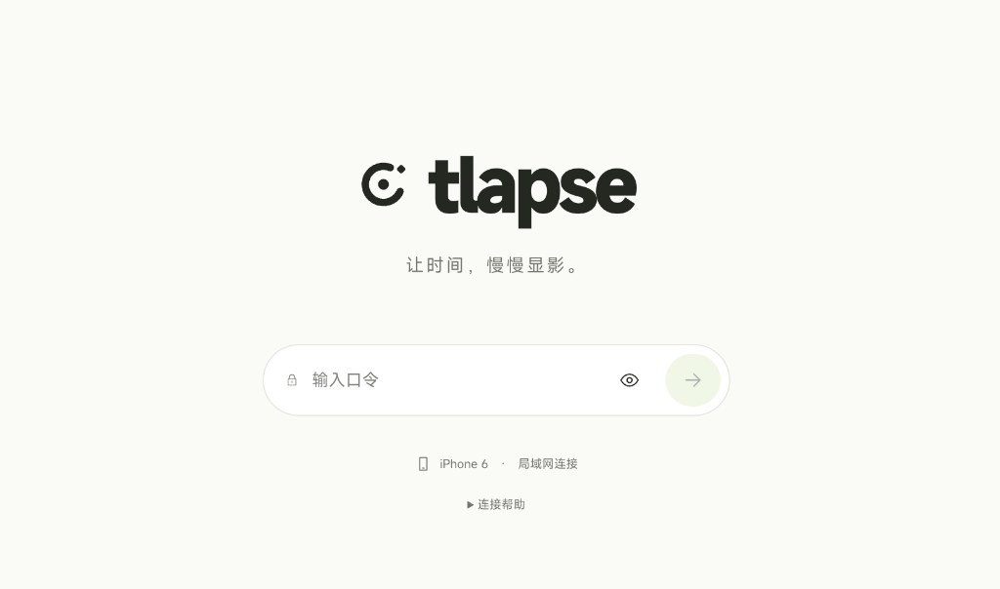

# tlapse

把闲置的越狱 iPhone 6 变成延时摄影相机：熄屏拍摄，在局域网浏览器里管理项目、查看照片和下载视频。



## 功能

- 多项目定时或手动拍摄，保存 JPEG 原图和缩略图。
- 对焦、曝光、白平衡锁定，方向校正、夜间跳过和静音请求。
- 将照片合成为 H.264 / MP4，支持每日或累计合成、目标时长抽帧。
- 可选 Telegram / WebDAV 上传、通知与原图保留策略。
- 网页控制台：项目管理、照片库、批量下载/删除、视频预览和日志。

## 适用环境与状态

面向 **iPhone 6 / iOS 12.5.7 / rootful 越狱**，不适用于未越狱设备或 App Store。
后端为 Objective-C 守护进程与摄像头组件，前端为 Vue 3 + Vite。

当前版本 `0.3.2`。已有真实 JPEG 拍摄、网页访问、单张静音确认，
以及千帧采集和千帧编码与拍摄重叠的真机记录；整体验收仍在进行。
完整上传流程和长期稳定性尚未完成真机验收。
其他机型、系统和地区的静音行为未保证，私有 API 也可能失效。

首次安装的示例项目默认暂停，上传默认关闭，不会自动开始拍摄。
控制台仅供可信局域网或受控 VPN 使用，**没有 HTTPS，不要映射到公网**。

## 从源码开始

需要 macOS、[Theos](https://theos.dev/docs/installation)、iPhoneOS SDK、`ldid` 和 Node.js 24。
在本仓库根目录执行：

```sh
export THEOS="$HOME/theos"
npm --prefix web ci
npm --prefix web run build
make package FINALPACKAGE=1
make -C camfix package FINALPACKAGE=1
```

两个安装包分别生成在 `packages/` 和 `camfix/packages/`。
安装前先阅读[安装与使用](docs/usage.md)，备份已有媒体和配置；不要把本地打包等同于真机验证通过。

只想预览网页，不连接手机：

```sh
npm --prefix web ci
npm --prefix web run dev:mock
```

使用终端显示的地址打开，演示口令为 `demo`。

## 文档

- [安装、配置与安全注意事项](docs/usage.md)
- [开发、构建与测试](docs/development.md)
- [首次推送 GitHub 与后续开发](docs/github.md)

欢迎通过 Issue / Pull Request 继续完善；提交问题时请去除真实口令、设备日志中的敏感信息和私人照片。

## 许可

[MIT](LICENSE)。字体及其他依赖保留各自许可，见[第三方声明](THIRD_PARTY_NOTICES.md)。
